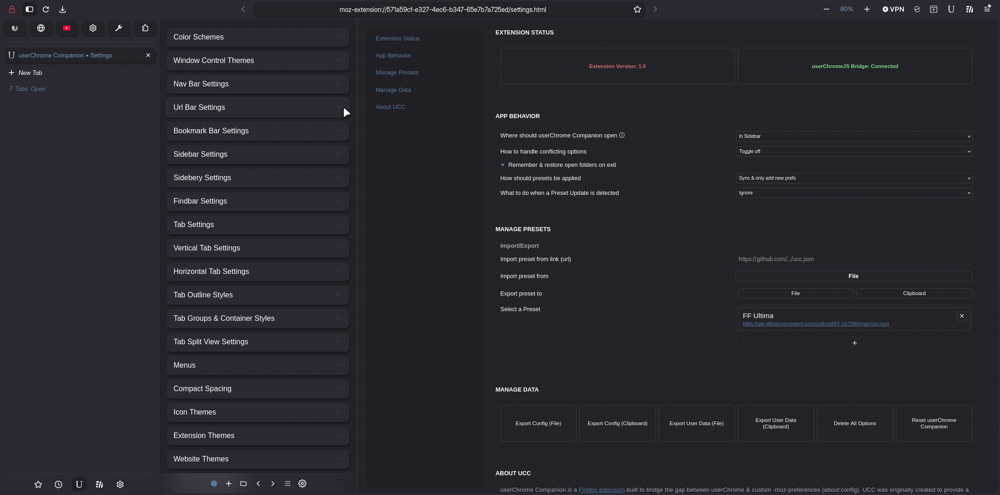

# This is userChrome Companion ...

###### ... a Firefox Extension to toggle & manage multiple userChrome styles

 

<!-- ------------------------------------------------------------------------------------------------- -->

## Overview

    userChrome Companion is a <a href="https://addons.mozilla.org/en-US/firefox/addon/userchrome-companion/">Firefox extension</a> built to bridge the gap between userChrome & custom -moz-preferences (about:config). In short, it lets you toggle/manage/organize preset list of preferences. UCC was originally created to provide a more smooth & comfortable experience for FF Ultima users. But it is not exclusive to one theme.

<ul>
    <li>Any theme that utilizes <code>-moz-pref</code>'s (user.js), can be used with this extension.</li>
    <li>Any theme that utilizes the <code>about:config</code> page to toggle settings, can be used with this extension.</li>
    <li>Any moz-pref (custom or native to Firefox) (like legacyUserProfileCustomizations.stylesheets) can be toggled with this extension.</li>
</ul>

<divider/>

  
    Normally, We userChrome Enjoyers, would have to manage & update user.js files ourselves. Then visit the about:config page. Then switch between different preferences. 
    Then we'd have to search & toggle certain -moz-pref's `off` depending on any conflicting -moz-pref that might be `on`.

  
    The extension makes this (and more) a lot easier by letting us manage & organize any -moz-preferences - straight from the sidebar. 
    With folders, presets, and conflicting -moz-prefs identified.. 
    All that's left for us to do is open the sidebar, click an option, and your new userChrome style is set.

 
    Linking to Presets is simple: enter a link to a <code>user.js</code> or <code>ucc.json</code> file (like <code>https://github.com/someones/repo/user.js</code>). Then select the preset..
    And linked Presets can be monitored for changes, meaning automatic up-to-date settings (without overwriting your personal configs)..
    Presets can also be created and imported from your own local files.
    Like mentioned above, the extension is not limited to custom preferences,
    so Presets can be used to toggle between whatever you want; from privacy configs, to userChrome styles.
    Like the name implies, Presets let you quickly switch between themes, settings, or layouts.

<divider/>

    Under the hood, UserChrome Companion is built to simply broadcast events onto itself, 
    and the userChromeJS side of things watches the extension events and reacts appropriately.
    The extension by itself (like any other extension) doesn't have the privilege of interacting with moz-preferences.
    And that's a good thing, because in accordance to Mozilla policies, we shouldn't even try to access elevated privilege from it.
    The extension can technically function on it's own like a personal bookmark, but it requires userChromeJS to actually act on toggling preferences.

## Setup

> If you are a user of FF Ultima, you can also skip these steps. Setup is automatically handled through theme install.

1. If you have userChromeJS (autoconfig) already setup, skip to step 3.
2. If you do not have userChromeJS setup, follow the steps below:
    - [dev/data/userchromejs/firefox/](https://github.com/soulhotel/userChrome-Companion/tree/main/dev/userchromejs)* -> your firefox directory
    - [dev/data/userchromejs/scripts/](https://github.com/soulhotel/userChrome-Companion/tree/main/dev/userchromejs) -> your chrome folder
    - [dev/data/userchromejs/utils/](https://github.com/soulhotel/userChrome-Companion/tree/main/dev/userchromejs)   -> your chrome folder.
    1. Everything `inside of the firefox folder` goes into your firefox install directory.
    2. the `scripts folder` sits inside of your chrome folder.
    3. The `utils folder` also sits inside of your chrome folder.
3. With userChromeJS setup, copy the extensionbridge files from the [`scripts folder`](https://github.com/soulhotel/userChrome-Companion/tree/main/dev/userchromejs) into your userChromejs scripts folder.
Once these files are in place, you'll need to restart Firefox via `about:support`s `Clear startup cache`.
4. From there you can grab the extension from the [Firefox Add-on store](https://addons.mozilla.org/en-US/firefox/addon/userchrome-companion/), if you haven't already.